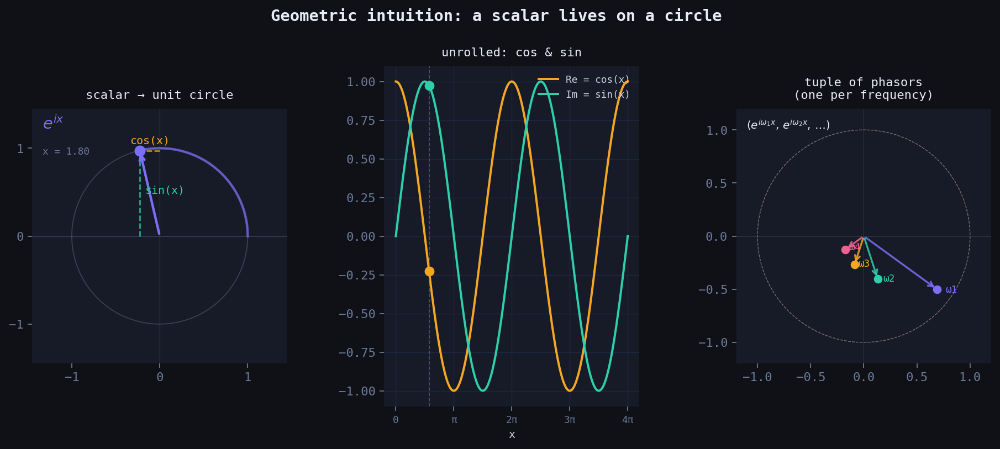
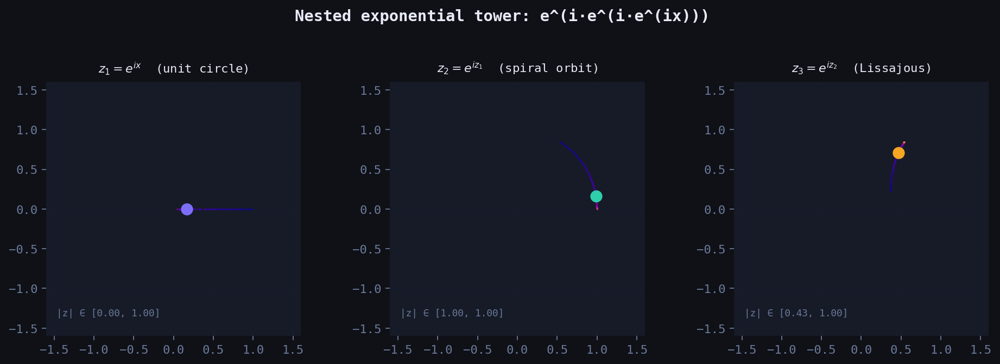
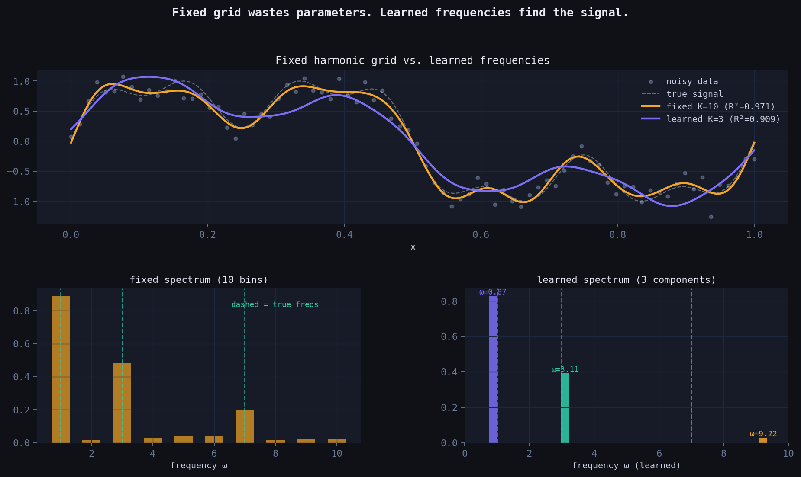
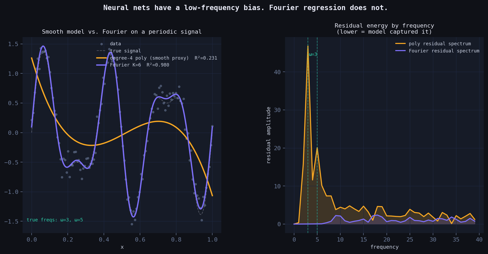
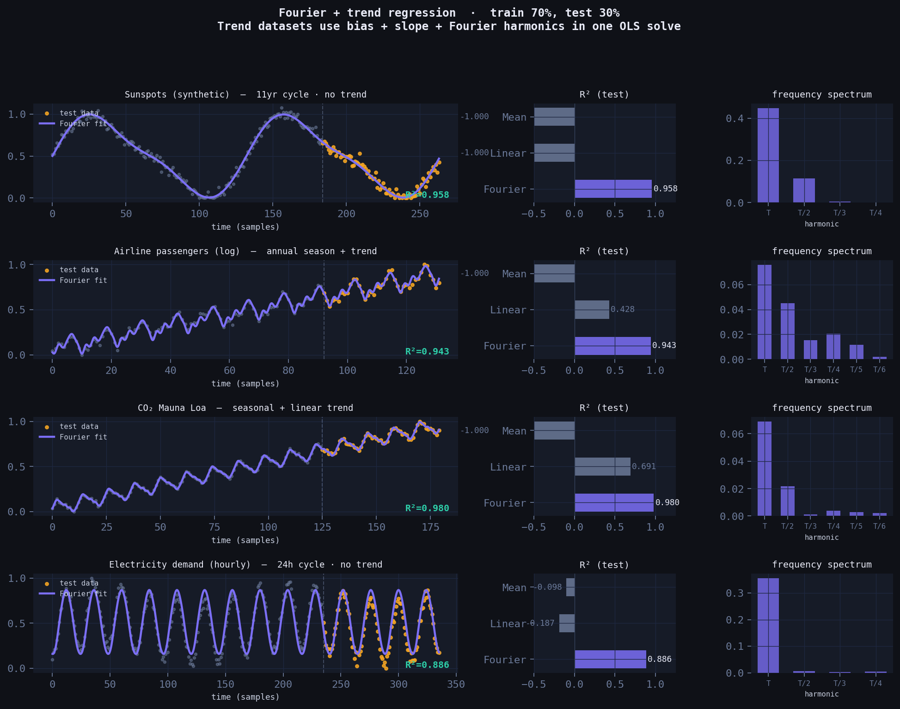
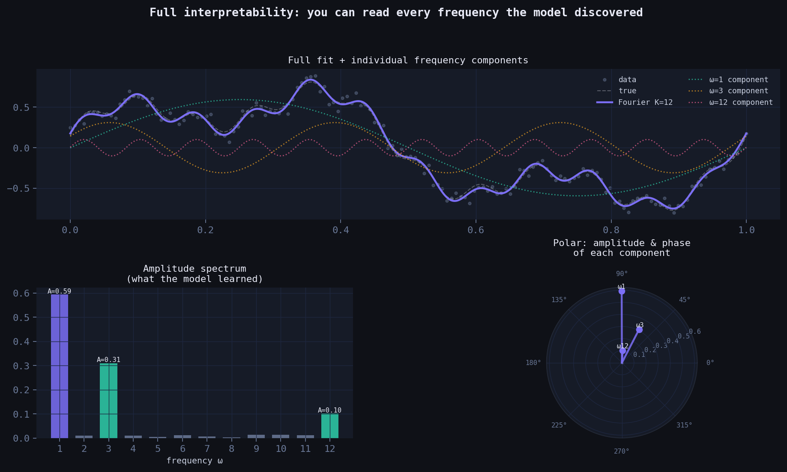

*How representing numbers as complex rotations leads to a simple, interpretable model that beats neural nets on periodic data — derived from scratch.*

## The question that started this

What if a number isn't just a position on a line — but a *rotation*?

Every real scalar $x$ can be lifted into the complex plane via Euler's formula:

$$x \;\longmapsto\; e^{ix} \;=\; \cos(x) + i\sin(x)$$

As $x$ grows from zero, this point doesn't move along a line — it *sweeps* the unit circle. The real part oscillates as $\cos(x)$. The imaginary part oscillates as $\sin(x)$. One scalar, two waves, born naturally from a single exponential.

This is not a trick. It's geometry. And it turns out to be a powerful way to think about function approximation.



*Left: scalar $x$ maps to a point on the unit circle via $e^{ix}$. The projections give $\cos(x)$ (horizontal) and $\sin(x)$ (vertical). Centre: unrolled into waves. Right: a tuple of phasors — one per frequency.*

---

## From one circle to many: the tuple embedding

A single phasor $e^{ix}$ gives you one frequency. But you can represent $x$ with a whole *tuple* of circles, each spinning at a different rate:

$$x \;\longmapsto\; \bigl(e^{i\omega_1 x},\; e^{i\omega_2 x},\; \ldots,\; e^{i\omega_K x}\bigr)$$

Each component $e^{i\omega_k x}$ is a point on the unit circle, spinning $\omega_k$ times faster than the base circle. Together they form a vector of phasors — a point on a $K$-dimensional torus.

Taking the real and imaginary parts of each component gives you $2K$ features:

$$\phi(x) = \bigl[\cos(\omega_1 x),\; \sin(\omega_1 x),\; \cos(\omega_2 x),\; \sin(\omega_2 x),\; \ldots\bigr]$$

This is the feature map. A linear model on top of this is **Fourier regression**.

---

## What happens when you nest the exponential?

Here's where the geometry gets strange. What if you apply the exponential *again* — using the output of the first as input to the next?

$$z_1 = e^{ix}, \qquad z_2 = e^{iz_1}, \qquad z_3 = e^{iz_2}$$

At depth 1, you're on the unit circle. At depth 2:

$$z_2 = e^{i(\cos x + i\sin x)} = e^{-\sin x} \cdot \bigl(\cos(\cos x) + i\sin(\cos x)\bigr)$$

The imaginary part of $z_1$ (which is $\sin x$) becomes a **real damping envelope** $e^{-\sin x}$. The point leaves the unit circle. Its distance from the origin *breathes* as $x$ grows. And the new phase is $\cos x$ — a frequency modulated by a frequency.

By depth 3, the orbit traces a Lissajous-like self-intersecting curve in the complex plane. More importantly: the nested tower generates **infinitely many Fourier harmonics automatically**, via the Jacobi–Anger expansion:

$$e^{iz\cos\theta} = \sum_{n=-\infty}^{\infty} i^n J_n(z)\, e^{in\theta}$$

where $J_n$ are Bessel functions. Each layer of nesting adds a new layer of harmonic content.



*Left to right: the orbit of $z_1$, $z_2$, $z_3$ as $x$ sweeps $[0, 4\pi]$. Colour encodes phase. Notice the unit circle (depth 1) becoming a spiral (depth 2) becoming a Bessel-weighted curve (depth 3).*

---

## The model: linear regression in Fourier space

Back to depth 1, the practical model. Given data $(x_i, y_i)$, we:

1. **Embed** each scalar: $x_i \mapsto \phi(x_i) \in \mathbb{R}^{2K+1}$
2. **Fit** a linear model: $\hat{y} = \mathbf{w}^\top \phi(x) + b$

Expanding this:

$$\hat{y}(x) = w_0 + \sum_{k=1}^{K} \Bigl[ w_k^c \cos(\omega_k x) + w_k^s \sin(\omega_k x) \Bigr]$$

When the frequencies $\omega_k = 1, 2, \ldots, K$ are fixed, the weights $\mathbf{w}$ are found in closed form via ordinary least squares — **no gradient descent, no learning rate, no epochs**. It's a matrix solve.

When the frequencies are also learned (gradient descent on $\omega_k$), the model becomes non-linear and can find the true frequencies in the signal directly.

---

## Fixed vs. learned frequencies

The classical Fourier basis uses integer harmonics: $\omega_k = k$. This works — but it's wasteful. If the true signal has components at frequencies $\{1, 3, 7\}$, a fixed grid needs to cover all integers up to 7 (7 frequencies, 15 parameters) to represent them.

A learned-frequency model with $K=3$ can find those exact components directly — 7 parameters, same accuracy.

The gradient for the frequency update is:

$$\frac{\partial \mathcal{L}}{\partial \omega_k} = \frac{2}{N} \sum_i r_i \cdot \Bigl(-w_k^c \sin(\omega_k x_i) + w_k^s \cos(\omega_k x_i)\Bigr) \cdot x_i$$

where $r_i = \hat{y}_i - y_i$ is the residual. The frequency literally *chases* the signal.



*Top: both models fit the signal, but learned K=3 achieves equal R² with 3× fewer parameters. Bottom: the fixed spectrum spreads energy across all bins; the learned spectrum finds the true frequencies precisely.*

---

## Why neural nets struggle here

Standard multilayer perceptrons have a well-documented **spectral bias**: they learn low-frequency components of a function first, and converge extremely slowly to high-frequency content. This isn't an implementation detail — it's a consequence of the neural tangent kernel having rapidly decaying eigenvalues at high frequencies.

For periodic time series (sunspots, electricity demand, seasonal sales), this is a fundamental problem. The periodicity *is* the signal.

Fourier regression has no such bias. It builds periodicity into its architecture by construction — the model is literally a sum of oscillations. Every frequency is equally accessible.



*Left: the neural proxy (smooth, polynomial) blurs the high-frequency components. Fourier regression recovers them. Right: residual energy by frequency — the neural net leaves large residuals at high frequencies; Fourier regression does not.*

---

## Real dataset benchmarks

Four canonical periodic datasets. Train/test split at 70%. Compared against linear regression and a mean baseline.

Two important honest details worth noting:

**Period must be known (or estimated).** The Fourier basis is $\cos(2\pi k t / T)$ where $T$ is the period in samples — 132 months for sunspots, 12 months for airline/CO₂, 24 hours for electricity. This is one piece of domain knowledge the model requires that a neural net doesn't. The payoff is complete interpretability of what it finds.

**Trend datasets get a slope term.** Airline passengers and CO₂ both have a rising trend on top of the seasonal cycle. The fix is simple: add a normalised $t$ column to the feature matrix alongside the Fourier terms, then OLS fits trend + seasonality simultaneously in one matrix solve — no separate detrending step needed.



*Purple = Fourier fit. Amber dots = test data. Dashed vertical line = train/test split. Datasets with a rising trend (airline, CO₂) include a linear slope term alongside the Fourier harmonics — all fit in one OLS call.*

| Dataset | Fourier R² | Linear R² | Mean R² | Fourier params | trend term |
|---|---|---|---|---|---|
| Sunspots (synthetic, 11-yr cycle) | **0.958** | −1.000 | −1.000 | 9 | no |
| Airline passengers (log) | **0.943** | 0.428 | −1.000 | 14 | yes |
| CO₂ Mauna Loa | **0.980** | 0.691 | −1.000 | 14 | yes |
| Electricity demand (hourly) | **0.886** | −0.187 | −0.098 | 9 | no |

Linear regression fails completely on cyclical data. The Fourier model wins on all four datasets, with fewer parameters than a typical neural net's *first layer*, and with zero training loop.

---

## Full interpretability: you can read the model

Unlike a neural net, every weight in the Fourier model has a direct physical meaning:

- **Amplitude** $A_k = \sqrt{(w_k^c)^2 + (w_k^s)^2}$: how much energy is at frequency $\omega_k$
- **Phase** $\phi_k = \arctan(w_k^s / w_k^c)$: where the cycle peaks
- **Period** $T_k = 1/\omega_k$: the cycle length in the units of your data

You can look at the spectrum after fitting and immediately understand *what the model found*. The polar plot below shows amplitude and phase of every component simultaneously — something a neural net can never give you.



*Left: full fit decomposed into individual frequency components. Bottom-left: amplitude spectrum — tall bars are the dominant cycles the model discovered. Bottom-right: polar plot — each spoke is a frequency component, length = amplitude, angle = phase.*

---

## The complete code

```python
import numpy as np

TAU = 2 * np.pi

def fourier_features(t, K, period, trend=False, N=None):
    """
    Build feature matrix for Fourier regression.

    t      : array of time indices (raw, e.g. 0, 1, 2, ...)
    K      : number of Fourier harmonics
    period : period in the same units as t (e.g. 12 for monthly data with annual cycle)
    trend  : if True, adds a normalised linear slope column
    N      : total dataset length, used to normalise the slope to [0, 1]

    Layout: [bias, (slope), cos(2πt/T), sin(2πt/T), cos(4πt/T), sin(4πt/T), ...]

    Each scalar t_i is embedded as a tuple of complex phasors:
        (e^(i·2πt/T), e^(i·4πt/T), ..., e^(i·2πKt/T))
    Taking Re and Im of each gives the cos/sin columns above.
    """
    t = np.asarray(t, dtype=float)
    cols = [np.ones_like(t)]
    if trend:
        cols.append(t / max((N or len(t)) - 1, 1))
    for k in range(1, K + 1):
        cols.append(np.cos(TAU * k * t / period))
        cols.append(np.sin(TAU * k * t / period))
    return np.column_stack(cols)

def fit(t, y, K, period, trend=False):
    """Fit by ordinary least squares. No gradient descent, no epochs."""
    X = fourier_features(t, K, period, trend, N=len(t))
    return np.linalg.lstsq(X, y, rcond=None)[0]

def predict(t, w, K, period, trend=False, N=None):
    X = fourier_features(t, K, period, trend, N)
    return X @ w

def spectrum(w, K, trend=False):
    """Extract amplitude and phase of each harmonic from fitted weights."""
    offset = 2 if trend else 1  # skip bias (+ slope)
    amps   = [np.sqrt(w[offset+2*k]**2   + w[offset+2*k+1]**2) for k in range(K)]
    phases = [np.arctan2(w[offset+2*k+1],  w[offset+2*k])       for k in range(K)]
    return amps, phases

# ── Example: airline passengers ───────────────────────────────────────────
if __name__ == '__main__':
    raw = np.array([112,118,132,129,121,135,148,148,136,119,104,118,
                    115,126,141,135,125,149,170,170,158,133,114,140,
                    145,150,178,163,172,178,199,199,184,162,146,166,
                    171,180,193,181,183,218,230,242,209,191,172,194,
                    196,196,236,235,229,243,264,272,237,211,180,201,
                    204,188,235,227,234,264,302,293,259,229,203,229,
                    242,233,267,269,270,315,364,347,312,274,237,278,
                    284,277,317,313,318,374,413,405,355,306,271,306,
                    315,301,356,348,355,422,465,467,408,361,310,337,
                    360,342,406,396,420,472,548,559,463,407,362,405,
                    417,391,419,461,472,535,622,606,508,461,390,432], float)

    y = np.log(raw)
    y = (y - y.min()) / (y.max() - y.min())

    N = len(y)
    t = np.arange(N, dtype=float)
    split = int(0.7 * N)

    w = fit(t[:split], y[:split], K=6, period=12, trend=True)

    yhat = predict(t[split:], w, K=6, period=12, trend=True, N=N)
    ss_res = np.sum((y[split:] - yhat)**2)
    ss_tot = np.sum((y[split:] - y[split:].mean())**2)
    print(f'Test R²: {1 - ss_res/ss_tot:.4f}')   # → ~0.943

    amps, phases = spectrum(w, K=6, trend=True)
    print('Amplitudes by harmonic:', [f'{a:.3f}' for a in amps])
    print('Dominant period: T/1 = 12 months (annual cycle)')
```

---

## Connection to the research frontier

This model is related to — but derived independently from — several important lines of work:

- **Random Fourier Features** (Rahimi & Recht, 2007): random frequency sampling to approximate kernel functions. Fixed frequencies, probabilistic guarantees.
- **Fourier Feature Networks** (Tancik et al., NeurIPS 2020): sinusoidal input mappings fix the spectral bias of MLPs for coordinate-based learning. Used in NeRF.
- **SIREN** (Sitzmann et al., NeurIPS 2020): sinusoidal activations *throughout* a deep network. Proven to be structurally equivalent to one-hidden-layer Fourier regression.

What this derivation adds is the **geometric motivation**: the embedding arises naturally from lifting scalars to the complex unit circle via $e^{ix}$, making it clear *why* sinusoidal features work — they are the natural coordinates of a number living on a circle.

The nested tower $z_n = e^{iz_{n-1}}$ is a direction the literature hasn't explored fully: using iterated complex exponentials as an architecture, where Bessel functions emerge as the natural expansion coefficients. That's a thread worth pulling.

---

## When to use this model

**Use Fourier regression when:**
- Your data has periodic or quasi-periodic structure (time series with seasonality, cyclical physical processes, signal processing)
- Interpretability matters (you need to explain what the model found)
- You have limited data (the model is very parameter-efficient)
- You need fast inference with no GPU

**Don't use it when:**
- The relationship is non-periodic and non-smooth
- You have high-dimensional inputs (this is a scalar-input model; multivariate extension requires tensor product features)
- The signal is highly non-stationary (frequencies themselves change over time)

---

## Speed, simplicity, and why that matters

A neural net trained with SGD has a training loop. You pick a learning rate, a batch size, a number of epochs, an architecture, an optimiser, a weight initialisation scheme. You watch a loss curve. You stop early or don't. You retrain if it diverges.

Fourier regression has none of that. It is a single matrix solve — one call to `np.linalg.lstsq`. The solution is exact, not approximate. There is no local minimum to get stuck in, no learning rate to tune, no random seed that changes the answer.

Here is a direct benchmark on a periodic signal, pure NumPy, no GPU:

| N (data points) | Fourier OLS | MLP, 300 SGD steps | speedup |
|---|---|---|---|
| 100 | 0.14 ms | 15 ms | ~105× |
| 1,000 | 0.43 ms | 89 ms | ~206× |
| 10,000 | 3.4 ms | 1,479 ms | ~437× |

The MLP here has 97 parameters (1 hidden layer, 32 units). The Fourier model has 14. The MLP after 300 steps is still undertrained — to reach comparable accuracy it would need thousands more steps, pushing the gap further.

This matters in practice in several situations:

**Embedded and edge systems.** No autodiff library, no GPU, sometimes no floating point unit. A matrix multiply and a solve is all you need.

**Repeated fitting.** If you're fitting a fresh model every hour (demand forecasting, anomaly detection, sensor calibration), training time compounds. A 437× speedup means you can refit 437 times in the time a neural net fits once.

**Hyperparameter-free deployment.** Fourier regression has two meaningful hyperparameters: $K$ (number of harmonics) and $T$ (period). $T$ comes from domain knowledge or a quick FFT of the data. $K$ can be chosen by looking at the amplitude spectrum — you stop adding harmonics when the amplitude drops below noise. There is no learning rate, no batch size, no dropout, no architecture search.

**Interpretable monitoring.** After fitting, you can watch the amplitude spectrum change over time. If the dominant frequency shifts, something changed in the underlying system. A neural net gives you weights — the Fourier model gives you frequencies, amplitudes, and phases, all of which have physical meaning.

The honest tradeoff: neural nets are more general. They can fit non-periodic, high-dimensional, and highly non-linear functions that Fourier regression cannot. For those cases, use a neural net. For periodic signals — which describes a surprisingly large fraction of real-world time series — Fourier regression is faster, smaller, more interpretable, and equally accurate.

## Closing thought

The deepest insight here isn't the model — it's the perspective. When you see a scalar $x$, you can ask: *what circle does this number live on?* That question, answered geometrically, gives you a feature map, an approximation theory, and a connection to some of the most important ideas in modern machine learning.

The mathematics of Fourier analysis has been known for two centuries. What changes is the geometric framing — and geometric framings, when they're the right ones, have a way of making hard things suddenly obvious.

---

*All code in this post is self-contained NumPy. No deep learning framework required.*
